# Awesome-Form-Filling-Automation-Productivity

  

  

  

  

  

  

# 📋 Top Form Filling Automation & Productivity

**Curated List of SaaS/Commercial Platforms & Open-Source GitHub Projects**  

*Focused on AI Form-Filling Extensions, Conversational Form Builders, Self-Hosted Survey Engines, JSON-Schema Form Renderers & Browser Autofill Automation*  

**Last updated: November 2026**

This repository tracks notable **SaaS/Commercial platforms** and **open-source projects** for **Form Filling Automation & Productivity**. These tools power browser-based AI form autofill extensions (`FastFiller`), conversational multi-step form builders, conditional logic workflows, GDPR-compliant self-hosted survey platforms (`Formbricks`, `HeyForm`, `LimeSurvey`), and schema-driven React/Vue form generators (`SurveyJS`, `JSON Forms`, `React Hook Form`) for productivity power-users, operations teams, and full-stack developers.

**Examples** include Google Forms (Google Workspace), SurveyMonkey, Typeform, Jotform, Formstack, Tally.so, Fillout, Feathery, Paperform, and FormKeep (the category leaders).

**🚀 Open-source emphasis**: This section is heavily expanded with every major active project for browser autofill & form-filling productivity (`FastFiller`, `Fake Filler`, `Skyvern`, `Browser-Use`), self-hosted conversational form & survey builders (`Formbricks`, `HeyForm`, `OpnForm`, `OhMyForm`, `LimeSurvey`, `Nextcloud Forms`), and developer JSON-schema form engines (`SurveyJS`, `React JSON Schema Form`, `FormKit`, `JSON Forms`) — ideal for users and teams seeking zero per-response caps, full GDPR/HIPAA data ownership, and automated form workflows.

🤝 Contributions welcome! Open a PR to add/update entries. Keep descriptions factual and link to official sites.

## 📑 Table of Contents

- [📊 Sector Overview & Market Dynamics](#-sector-overview--market-dynamics)

- [☁️ SaaS/Hosted & Commercial Platforms](#️-saashosted--commercial-platforms)

- [💻 Open-Source GitHub Projects](#-open-source-github-projects)

- [🛠️ How to Contribute](#️-how-to-contribute)

- [⚠️ Disclaimer](#️-disclaimer)

- [💖 Support & Thank You](#-support--thank-you)

## 📊 Sector Overview & Market Dynamics

The global Online Form Builder, Survey Software & Workflow Data-Capture market is valued at approximately **$9.8B–$12.4B+ in 2026**, expanding at a ~12%–16% CAGR propelled by AI form generation, autonomous browser form-filling agents, and zero-party customer data workflows. The commercial form-builder layer is **moderately fragmented**—anchored by horizontal giants (Google Forms, SurveyMonkey, Jotform, Typeform) alongside modern developer/no-code challengers (Tally.so, Fillout, Feathery)—while the self-hosted survey and schema-form engineering layers are **rapidly growing around open-source platforms** (`Formbricks`, `HeyForm`, `OpnForm`, `LimeSurvey`, `SurveyJS`).

## ☁️ SaaS/Hosted & Commercial Platforms

*Sorted descending by company valuation / annual revenue scale.*

| Platform | Description | Company Scale (Valuation / Revenue) | Starting Paid Tier | Free Tier / Trial Limit |

| :--- | :--- | :--- | :--- | :--- |

| **[Google Forms (Google Workspace)](https://google.com)** | Free cloud form and quiz builder integrated natively with Google Sheets, Google Classroom, and Workspace Gemini AI. | **Part of Alphabet Inc.** (~$350B+ Alphabet revenue; ~$2T+ market cap) | **$6.00 / user / month** billed annually (Workspace Business Starter; $0 personal) | **Forever Free Personal Account** (Unlimited forms, unlimited questions, and **unlimited responses** shared across 15 GB Google Drive) |

| **[SurveyMonkey](https://surveymonkey.com)** | Enterprise survey, market research, and automated feedback platform with AI survey generation, branching logic, and sentiment analytics. | **~$1.5B Take-Private Valuation** (~$500M+ annual revenue) | **$25 / user / month** billed annually (Team Advantage, 3-user min) or **$39 / mo** Individual Advantage | **Forever Free Basic Plan** (Unlimited surveys, up to **10 questions per survey**, and **25–40 viewable responses per survey**) |

| **[Typeform](https://typeform.com)** | Conversational one-question-at-a-time form, quiz, and lead-capture platform renowned for high completion rates and conditional logic flows. | **~$935M Valuation** (~$100M+ est. ARR; $187M+ VC funding) | **$25 / month** billed annually ($29/mo monthly for Basic plan, includes 100 responses/mo) | **Forever Free Plan** (Unlimited forms, up to **10 questions per form**, and **10 total responses per month** across all forms) |

| **[Jotform](https://jotform.com)** | All-in-one online form builder, Smart PDF Form autofiller, approval workflow engine, and e-signature platform with 10,000+ templates. | **~$500M–$1.0B+ Est. Valuation** (~$120M+ est. ARR; bootstrapped; >25M users) | **$34 / month** billed annually ($39/mo monthly for Bronze plan, 25 forms & 1,000 submissions/mo) | **Forever Free Starter Plan** (Up to **5 active forms**, **100 monthly submissions**, 100 MB storage, and 10 monthly payment/signed docs) |

| **[Formstack](https://formstack.com)** | Enterprise workplace productivity suite combining no-code forms, automated document generation, and e-signatures for healthcare and finance. | **~$400M–$600M Est. Valuation** (Backed by PSG & Silversmith; ~$80M+ est. ARR) | **$83 / month** billed annually ($99/mo monthly for Forms plan, 20 forms & 1,000 submissions/mo) | **14-Day Full-Access Free Trial** (Includes Forms, Documents, and Sign evaluation without credit card; no perpetual free tier) |

| **[Tally.so](https://tally.so)** | Notion-style block-based form builder offering generous unlimited forms/submissions, conditional logic, payment collection, and custom domains. | **~$15M–$30M Est. Valuation** (~$3M–$5M+ ARR; profitable bootstrapped European SaaS) | **$24 / month** billed annually ($29/mo monthly for Tally Pro) | **Forever Free Plan** (**Unlimited forms and unlimited submissions** free forever, including conditional logic, file uploads up to 10 MB, and Stripe payments) |

| **[Fillout](https://fillout.com)** | Modern form, scheduling, and workflow builder with deep native two-way sync for Airtable, Notion, HubSpot, Salesforce, and PostgreSQL. | **~$20M–$40M Est. Valuation** (YC-backed; ~$3M–$6M+ est. ARR) | **$15 / month** billed annually ($19/mo monthly for Starter plan, 2,000 responses/mo) | **Forever Free Plan** (Unlimited forms, up to **1,000 responses per month**, native Airtable/Notion/Google Sheets sync, and conditional logic) |

| **[Feathery](https://feathery.io)** | Developer-friendly, high-customization form and onboarding workflow builder with React/JS SDKs, API connectors, and AI PDF-to-form conversion. | **~$20M–$40M Est. Valuation** (YC-backed; ~$10M+ VC funding) | **$49 / month** billed annually ($59/mo monthly for Basic plan, 1,000 submissions/mo) | **Forever Free Starter Plan** (Up to **5 live forms** and **250 submissions per month** with full conditional logic and native integrations) |

| **[Paperform](https://paperform.co)** | Document-style form, landing-page, booking, and e-commerce checkout builder blending free-form editorial text with smart calculation fields. | **~$15M–$25M Est. Scale** (Profitable bootstrapped Australian SaaS) | **$24 / month** billed annually ($29/mo monthly for Essentials, 1,000 submissions/mo) | **14-Day Full-Access Free Trial** (Includes unlimited test forms, calculations, and bookings during 14-day evaluation; no perpetual free tier) |

| **[FormKeep](https://formkeep.com)** | Developer-focused form backend and static-site endpoint service handling HTML form submissions, spam filtering, and webhook routing. | **~$5M–$10M Est. Scale** (Bootstrapped developer SaaS by thoughtbot alumni) | **$4.99 / month** billed annually ($5.99/mo monthly for Solo plan, 500 submissions/mo) | **Forever Free Trial / Starter Tier** (Up to **50 form submissions/month** and 1 form endpoint free forever; 14-day full plan trial) |

## 💻 Open-Source GitHub Projects

| Project | License / Hosting Cost | Free Tier / Self-Hosted Limit | Description |

| :--- | :--- | :--- | :--- |

| **[FastFiller (`mauryaankur99/FastFiller`)](https://github.com)** | **Open-Source** ($0 browser extension / local form-filling productivity tool) | **100% Free forever** (Unlimited one-click form autofill profiles, custom field mappings, and instant form completion locally) | Open-source browser productivity extension built to automate repetitive web form filling with saved profiles and smart field detection. |
